<div align="center">



<br><br>

[](https://github.com/BHUVI-SHIP-IT)
[](https://github.com/BHUVI-SHIP-IT)
[](https://linkedin.com/in/bhuvaneswar123)
[](https://gamified-portfolio-bhuvi.vercel.app/)
[](mailto:bhuvaneswar981@gmail.com)

<br>

<a href="https://github.com/BHUVI-SHIP-IT">
  
</a>

</div>

<br>

<!-- ═══════════════════════════════════════════════════════════════ -->

<div align="center">

```
╔══════════════════════════════════════════════════════════════════════╗
║                                                                      ║
║   > SYSTEM INITIALIZATION: COMPLETE                                  ║
║   > IDENTITY: M BHUVANESWAR                                         ║
║   > DESIGNATION: SOFTWARE ENGINEER // AI SYSTEMS ARCHITECT           ║
║   > LOCATION: CHENNAI, INDIA                                         ║
║   > EDUCATION: B.E. CSE — CHENNAI INSTITUTE OF TECHNOLOGY            ║
║   > STATUS: BUILDING THE FUTURE                                      ║
║                                                                      ║
║   "Code is the language. Imagination is the architecture."           ║
║                                                                      ║
╚══════════════════════════════════════════════════════════════════════╝
```

</div>

<br>


<br>

## `> CLASSIFIED // PERSONNEL DATABASE`

<table>
<tr>
<td width="50%">

**IDENTITY FILE**

| Field | Data |
|:------|:-----|
| **Name** | M Bhuvaneswar |
| **Codename** | BHUVI-SHIP-IT |
| **Education** | B.E. CSE, CIT Chennai — CGPA 8.4 |
| **Clearance** | Azure AI-901 Certified |
| **LeetCode** | 600+ solved · Rating 1756 |
| **Status** | Active · Engineering Year 2 |

</td>
<td width="50%">

**CORE DIRECTIVES**

```
MISSION PARAMETERS:
├── Build AI-powered distributed systems
├── Engineer multi-agent architectures
├── Design cloud-native infrastructure
├── Develop full-stack applications
└── Push the boundaries of agentic AI

CURRENT OBJECTIVE:
→ Multi-agent systems & local LLM deployment
```

</td>
</tr>
</table>

<br>


<br>

## `> TECHNOLOGY ARSENAL // VERIFIED CAPABILITIES`

<div align="center">

**`PROGRAMMING LANGUAGES`**


<br><br>

**`AI / MACHINE LEARNING`**


&nbsp;


<br><br>

**`AGENTIC / LLM FRAMEWORKS`**


<br><br>

**`FULL STACK DEVELOPMENT`**


<br><br>

**`CLOUD / DEVOPS`**


<br><br>

**`DATABASES`**


&nbsp;


</div>

<br>


<br>

## `> EXPERIMENTAL LAB // SELECTED ENGINEERING PROJECTS`

<br>

<div align="center">
<i>"Don't wait for the future. Build the infrastructure for it."</i>
</div>

<br>

<!-- PROJECT 1: TRACEOPS -->
<table>
<tr>
<td>

### `MISSION 01` — [TraceOps](https://github.com/BHUVI-SHIP-IT/TRACEOPS)

> **AI-Driven Infrastructure Root Cause Analysis System**

Built an observability system that performs automated root cause analysis across distributed microservices. Designed causal dependency graphs and anomaly detection pipelines to detect failure propagation. Implements AI remediation suggestions for automated debugging workflows.


[`> ACCESS REPOSITORY`](https://github.com/BHUVI-SHIP-IT/TRACEOPS)

</td>
</tr>
</table>

<!-- PROJECT 2: FORENSIQ -->
<table>
<tr>
<td>

### `MISSION 02` — ForensIQ

> **Hybrid AI–Deterministic Forensic Intelligence & Evidence Correlation System**

Developed a forensic intelligence system for cross-source evidence analysis and decision support. Engineered geospatial, temporal, and forensic reasoning engines for contradiction detection and explainable insights. Production-grade full-stack platform with automated evidence ingestion, audit logging, and real-time case updates.


</td>
</tr>
</table>

<!-- PROJECT 3: DEEPSOLVE -->
<table>
<tr>
<td>

### `MISSION 03` — [DeepSolve](https://github.com/BHUVI-SHIP-IT/Deep-Solve---ai-rag-research-project)

> **Multi-Agent LLM Research Assistant**

Autonomous multi-agent AI system capable of end-to-end research and structured report generation. Implements agent planning, memory management, and tool execution pipelines. Integrates RAG using vector databases with multi-hop retrieval strategies.


[`> ACCESS REPOSITORY`](https://github.com/BHUVI-SHIP-IT/Deep-Solve---ai-rag-research-project)

</td>
</tr>
</table>

<div align="center">
<br>
<i>"Reality is just another system waiting to be understood."</i>
<br><br>
</div>

<!-- PROJECT 4: DEBATRON -->
<table>
<tr>
<td>

### `MISSION 04` — [Debatron](https://github.com/BHUVI-SHIP-IT/multi-agent-debate-system)

> **Multi-Agent Debate System**

Engineered a multi-agent debate system orchestrating moderator, research, pro, opponent, fact-checker, and verdict agents to autonomously analyze topics, challenge arguments, and generate structured conclusions. Grounded RAG pipeline combining real-time search with semantic retrieval for evidence-backed responses.


[`> ACCESS REPOSITORY`](https://github.com/BHUVI-SHIP-IT/multi-agent-debate-system)

</td>
</tr>
</table>

<!-- PROJECT 5: AUTOBUILD -->
<table>
<tr>
<td>

### `MISSION 05` — Autobuild

> **Local-LLM Agentic Software Development & Automation Platform**

Autonomous planner–builder system that decomposes requirements, implements code, and verifies results through iterative agent workflows. Real-time, local-first platform with multi-provider LLM support, persistent sessions, tool execution, approval gates, and automated SDLC orchestration.


</td>
</tr>
</table>

<br>


<br>

## `> MISSION HISTORY // FIELD OPERATIONS`

<table>
<tr>
<td width="120" align="center"><b>PERIOD</b></td>
<td><b>OPERATION</b></td>
</tr>
<tr>
<td align="center"><code>07–08/2026</code></td>
<td><b>Alldigi-tech</b> · Product & AI Engineering Intern — Built scalable ticket-based support system with elevation pipeline & policy compliance RAG system</td>
</tr>
<tr>
<td align="center"><code>04–06/2026</code></td>
<td><b>Brakes India</b> · Enterprise Real-time AI Integration Intern — AI inventory retrieval system for warehouse operations & automated engineering design tasks</td>
</tr>
<tr>
<td align="center"><code>08–09/2025</code></td>
<td><b>CoinSwitch</b> · Frontend Engineer Intern — High-performance UI for large-scale crypto trading platform with REST API integration</td>
</tr>
</table>

<br>

## `> MILESTONES // ACHIEVEMENTS UNLOCKED`

<table>
<tr>
<td width="120" align="center"><b>DATE</b></td>
<td><b>ACHIEVEMENT</b></td>
</tr>
<tr>
<td align="center"><code>07/2026</code></td>
<td>🏅 <b>Microsoft Azure AI-901</b> — Certified</td>
</tr>
<tr>
<td align="center"><code>05/2026</code></td>
<td>🥉 <b>AIVENTRA Industrial Hackathon</b> — 3rd Place ($1000 prize)</td>
</tr>
<tr>
<td align="center"><code>06/2025</code></td>
<td>⚡ <b>LeetCode</b> — 600+ problems solved · Max Rating: 1756</td>
</tr>
<tr>
<td align="center"><code>05/2025</code></td>
<td>🏆 <b>Hackfinity Hackathon</b> — Winner, Best Innovative Solution</td>
</tr>
</table>

<br>


<br>

## `> COMMAND CENTER // GITHUB ANALYTICS`

<div align="center">


<br>


<br><br>


<br>

<picture>
  <source media="(prefers-color-scheme: dark)" srcset="https://raw.githubusercontent.com/BHUVI-SHIP-IT/BHUVI-SHIP-IT/output/github-snake-dark.svg" />
  <source media="(prefers-color-scheme: light)" srcset="https://raw.githubusercontent.com/BHUVI-SHIP-IT/BHUVI-SHIP-IT/output/github-snake.svg" />
  
</picture>

</div>

<br>


<br>

## `> LIVE OPERATIONS // CURRENT FOCUS`

<div align="center">

```
┌─────────────────────────────────────────────────────┐
│  ACTIVE RESEARCH VECTORS                            │
│                                                     │
│  [■■■■■■■■░░]  Agentic AI & Multi-Agent Systems    │
│  [■■■■■■■░░░]  Local LLM Deployment                │
│  [■■■■■■░░░░]  Cloud-Native Architecture            │
│  [■■■■■■■■░░]  AI-Assisted Software Engineering    │
│                                                     │
│  STATUS: ALL SYSTEMS NOMINAL                        │
└─────────────────────────────────────────────────────┘
```

</div>

<br>


<br>

## `> COMMUNICATION TERMINAL // ESTABLISH CONNECTION`

<div align="center">

[](https://github.com/BHUVI-SHIP-IT)
[](https://linkedin.com/in/bhuvaneswar123)
[](https://gamified-portfolio-bhuvi.vercel.app/)
[](mailto:bhuvaneswar981@gmail.com)

<br><br>

*"The universe has boundaries. Curiosity doesn't."*

<br>

```
╔══════════════════════════════════════════════════════╗
║  THE NEXT CHAPTER IS STILL BEING ENGINEERED.        ║
╚══════════════════════════════════════════════════════╝
```

<br>


</div>
